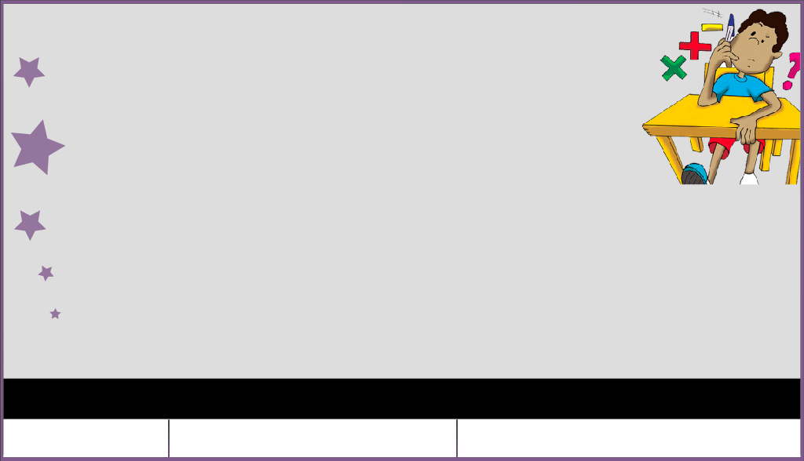

# Reproductor Educativo Accesible LSC (Lengua de Señas Colombiana)


-005A9C.svg)


Reproductor web educativo accesible diseñado para enseñar matemáticas a estudiantes con discapacidad auditiva mediante **Lengua de Señas Colombiana (LSC)**, subtítulos sincronizados (`CC`), control de velocidad de reproducción y un **Glosario Matemático interactivo en LSC**.



---

## Características principales (v2.0.0)

1. **Sincronización multicapa en tiempo real (HTML5 nativo, sin dependencias obsoletas)**:
   - Sincroniza automáticamente tres flujos de video (`media/teoria.mp4`, `media/interprete.mp4` y `media/CC.mp4`) corrigiendo cualquier desfase de tiempo (`< 0.2s`).
   - Elimina por completo la dependencia histórica de *Adobe Edge Animate Runtime* (`edge.5.0.0.min.js`) y *jQuery 2.0.3*.
2. **Accesibilidad Web bajo WCAG 2.2 (Niveles A, AA y AAA)**:
   - **`1.2.6 Sign Language (Prerecorded) [AAA]`**: Intérprete en Lengua de Señas Colombiana sincronizado, con **Modo Lado a Lado (`Side-by-Side`)** para que la ventana del intérprete nunca tape las fórmulas de la pizarra, selector de **4 esquinas** en modo flotante y botón **Ampliar / Reducir**.
   - **`1.2.2 Captions (Prerecorded) [A]`**: Franja de subtítulos (`CC`) activable o desactivable en cualquier momento, incluso en **Pantalla Completa multicapa**.
   - **`2.1.1 Keyboard [A]` y `2.4.7 Focus Visible [AA]`**: Todos los controles del reproductor y del glosario son `<button>` e `<input>` nativos operables por teclado, con indicador de foco de alto contraste (`:focus-visible`) y enlace de salto (*Skip link*).
   - **`4.1.2 Name, Role, Value [A]` y `4.1.3 Status Messages [AA]`**: Estados `aria-pressed`, etiquetas `aria-label` y anuncios en vivo (`role="status"`, `aria-live="polite"`).
3. **Control de velocidad pedagógico (`25%`, `50%`, `100%`), Bucle `A → B` y barra de progreso**:
   - Permite reducir la velocidad al **50%** o **25%** y marcar un **Tramo `A → B` en bucle** para repetir una explicación compleja en LSC tantas veces como el estudiante lo necesite.
4. **Glosario Matemático Interactivo y Modo Práctica en LSC (`glosario/index.html` y Modal integrado)**:
   - Catálogo de **12 conceptos algebraicos** con acceso rápido desde la pantalla principal (`?termino=...`), filtros por categoría matemática (*Ecuaciones*, *Funciones*, *Polinomios y Álgebra*, *Fundamentos*), buscador en tiempo real y cámara lenta (`50%`).
   - **Modo Práctica / Autoevaluación LSC (`?modo=practica`)**: Muestra una seña matemática en LSC para que el estudiante identifique el concepto correspondiente entre 4 opciones con retroalimentación accesible inmediata.

---

## Atajos de teclado

| Tecla | Acción en el Reproductor |
| :--- | :--- |
| `Espacio` o `K` | Reproducir / Pausar la lección |
| `←` / `→` | Retroceder / Adelantar 5 segundos |
| `I` | Mostrar / Ocultar ventana del intérprete LSC |
| `L` | Alternar vista **Lado a Lado** (pizarra + intérprete sin superposición) |
| `C` | Mostrar / Ocultar subtítulos (CC) |
| `M` | Silenciar / Activar audio |
| `F` | Alternar Pantalla Completa multicapa |
| `G` | Abrir el Glosario Matemático LSC en ventana modal |
| `Esc` | Cerrar el modal del Glosario Matemático |

---

## Uso local

No requiere instalación de paquetes ni compilación. Puedes abrir `index.html` directamente en cualquier navegador moderno o servir la carpeta con un servidor estático local:

```bash
python3 -m http.server 8000
# Abrir http://localhost:8000 en el navegador
```

Consulta el detalle de cambios en [`CHANGELOG.md`](./CHANGELOG.md).

## Licencia

Distribuido bajo la licencia [MIT](./LICENSE). Autor: **Diego Javier Mena Amado** (`@ingelectronicadj`).
