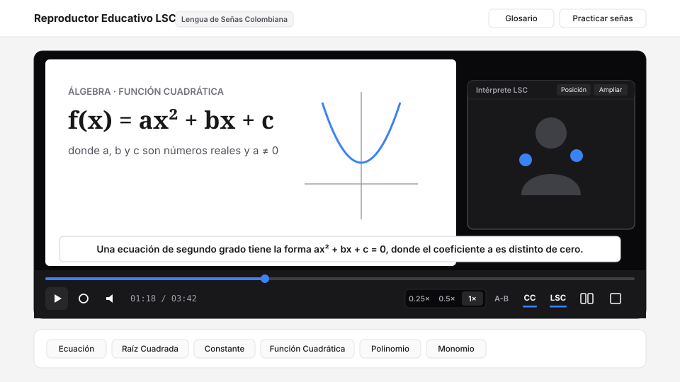

# Reproductor Educativo Accesible LSC (Lengua de Señas Colombiana)


-2563eb.svg)


Reproductor web educativo con diseño minimalista y accesible para la enseñanza de matemáticas en **Lengua de Señas Colombiana (LSC)**, equipado con subtítulos sincronizados (`CC`), control de velocidad (`0.25x`, `0.5x`, `1x`), repetición de tramos `A-B`, vista dividida lado a lado y un **Glosario Matemático interactivo en LSC**.



---

## Características principales (v2.0.0)

1. **Barra de controles con ergonomía estándar de video (HTML5 y CSS nativo)**:
   - Sincroniza automáticamente tres flujos de video (`media/teoria.mp4`, `media/interprete.mp4` y `media/CC.mp4`) corrigiendo cualquier desfase de tiempo (`< 0.2s`), sin depender de librerías obsoletas (*Adobe Edge Animate* ni *jQuery*).
   - Disposición familiar de controles: transporte y tiempo a la izquierda (*Play/Pausa*, *Reiniciar*, *Volumen* y `00:00 / 00:00`) y herramientas de aprendizaje/accesibilidad a la derecha (*Velocidad `0.25x / 0.5x / 1x`*, *Bucle `A-B`*, *`CC`*, *`LSC`*, *Vista lado a lado* y *Pantalla completa*).
   - Sistema de iconos construido íntegramente con geometría CSS (`::before` / `::after`).
2. **Accesibilidad Web bajo WCAG 2.2 (Niveles A, AA y AAA)**:
   - **`1.2.6 Sign Language (Prerecorded) [AAA]`**: Intérprete en Lengua de Señas Colombiana sincronizado, con **Modo Vista Dividida (Lado a Lado)** para que la ventana del intérprete nunca tape las fórmulas de la pizarra, cambio de esquina (`Posición`) y ajuste de tamaño (`Ampliar / Reducir`).
   - **`1.2.2 Captions (Prerecorded) [A]`**: Franja de subtítulos (`CC`) activable o desactivable en cualquier momento, incluso en **Pantalla Completa multicapa**.
   - **`2.1.1 Keyboard [A]` y `2.4.7 Focus Visible [AA]`**: Controles semánticos `<button>` e `<input>` operables por teclado, con indicador de foco visible (`:focus-visible`) y enlace de salto (*Saltar al reproductor*).
   - **`4.1.2 Name, Role, Value [A]` y `4.1.3 Status Messages [AA]`**: Estados `aria-pressed`, etiquetas `aria-label` y anuncios en vivo (`role="status"`, `aria-live="polite"`).
3. **Glosario Matemático Interactivo y Modo Práctica en LSC (`glosario/index.html` y Modal integrado)**:
   - Catálogo de **12 conceptos algebraicos** con acceso rápido desde la pantalla principal (`?termino=...`), filtros por categoría matemática (*Ecuaciones*, *Funciones*, *Polinomios y Álgebra*, *Fundamentos*), buscador en tiempo real y reproducción a mitad de velocidad (`0.5x`).
   - **Modo Práctica / Autoevaluación LSC (`?modo=practica`)**: Permite practicar el reconocimiento de señas matemáticas en LSC con retroalimentación accesible inmediata.

---

## Atajos de teclado

| Tecla | Acción en el Reproductor |
| :--- | :--- |
| `Espacio` o `K` | Reproducir / Pausar la lección (también haciendo clic sobre el video) |
| `Flecha Izquierda` / `Derecha` | Retroceder / Adelantar 5 segundos |
| `I` | Mostrar / Ocultar ventana del intérprete LSC |
| `L` | Alternar vista dividida **Lado a Lado** (pizarra + intérprete sin superposición) |
| `C` | Mostrar / Ocultar subtítulos (`CC`) |
| `M` | Silenciar / Activar audio |
| `F` | Alternar Pantalla Completa multicapa |
| `G` | Abrir el Glosario Matemático LSC en ventana modal |
| `Esc` | Cerrar el modal del Glosario Matemático |

---

## Uso local

No requiere instalación de paquetes ni compilación. Puedes servir la carpeta con cualquier servidor estático local:

```bash
python3 -m http.server 8090
# Abrir http://localhost:8090 en el navegador
```

Consulta el detalle de cambios en [`CHANGELOG.md`](./CHANGELOG.md).

## Licencia

Distribuido bajo la licencia [MIT](./LICENSE). Autor: **Diego Javier Mena Amado** (`@ingelectronicadj`).
